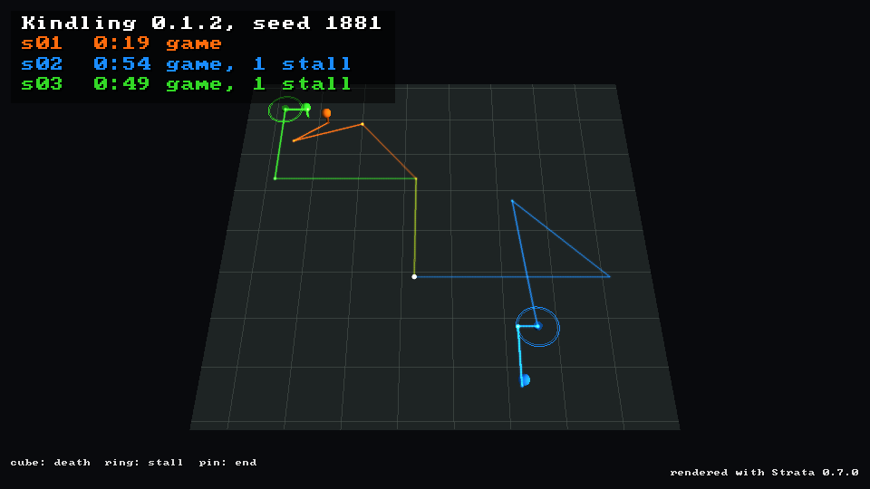

# Playtesting with AI agents

Playtester's agent kit has several AI agents (for example Claude Code
subagents) play the **real** game at once, each toward a different goal, the
way a person would: they look at screenshots and press keys and click. Each
writes a structured report, and the reports are merged into one summary.

- **`pt`**, the harness, runs one isolated session of a game (its own
  virtual display, saves, screenshots and logs) and drives it with keys and
  the mouse ([`playtester.harness`](../src/playtester/harness/)).
- A **profile** tells it how to build, start, see and steer one game
  ([PROFILES.md](PROFILES.md)). Beyond Nations, Kindling, Atman and a small demo game
  are bundled, and Kindling, Atman, steading, orrery and Sisyphus also have
  profiles on the [Strata driver](#the-strata-driver).
- A game may implement the optional **probe**: it writes what the player sees
  to `state.json` and `events.jsonl`, so agents can steer precisely and
  objectives can be timed from the game's own events
  ([PROBE_CONTRACT.md](PROBE_CONTRACT.md)).
- Each agent follows a prompt filled in by `pt prompt`
  ([template](../src/playtester/data/prompts/AGENT_PROMPT.md)) and writes a
  `report.json` ([schema](../src/playtester/data/schemas/report.schema.json)).
- A profile may list **questions** each agent answers at the end of its
  session, in its own words, beside its findings (Atman's ask what the game
  seemed to be about). `pt report` checks that each one is answered.
- `pt aggregate` merges a run into `summary.md` and `summary.json`, with the
  agents' answers side by side under each question.
- The **coordinator skill** (`pt install-skill <game checkout> --profile NAME`
  installs it as `.claude/skills/playtest/SKILL.md`) is the procedure, start
  to finish: preflight, build, smoke, spawn N agents, wait, clean up,
  aggregate, commit the evidence, offer issues.

This sits beside playtester's original automation loop (screenshot ->
decision engine -> executor, with mocked AI); neither depends on the other.

## Install

Linux (or WSL2) with Python 3.8 or newer, and:

- `Xvfb`, `xdotool` and ImageMagick's `import`; `flock` comes from the standard library
- for games that render with OpenGL, Mesa's llvmpipe (`libgl1-mesa-dri`); the
  harness exports `LIBGL_ALWAYS_SOFTWARE=1 GALLIUM_DRIVER=llvmpipe` for both
  Xvfb and the game (Xvfb aborts on WSL2 without them)
- whatever the game itself needs to build and run

```bash
sudo apt-get install -y xvfb xdotool imagemagick libgl1-mesa-dri
pip install -e .            # from a playtester checkout; gives `pt` and `playtester`
# or, without a checkout: pip install git+https://github.com/Preponderous-Software/playtester
pt profiles
PT_ROOT=/tmp/pt-try pt smoke --profile demo     # PASS proves the machine can run the kit
```

pip cannot install the system packages. The harness is standard-library
Python: it imports nothing from the automation loop, so it needs no display
and installing playtester installs no Python packages (`pyautogui`, `pynput`
and `pillow` belong to the experimental automation framework and come with
the `automation` extra only).

The bundled Beyond Nations, Kindling and Atman profiles play games you clone and
build yourself; the README's [Bundled games](../README.md#bundled-games)
section has the commands and the minimum version each needs.

## One session by hand

```bash
export PT_ROOT=/tmp/pt-try PT_SESSION=me             # each shell call needs these
pt start --profile beyond-nations --game-dir ~/beyond-nations --seed 42
pt shot title                                         # prints the PNG path; open it
pt key space                                          # leave the title
pt click 480 315                                      # Start
pt click 480 315                                      # Begin (the seed is filled in)
pt await WORLD
pt state                                              # compact state.json
pt walkto tree                                        # turn to it, walk until within reach
pt key e                                              # chop
pt events 5                                           # what the game says happened
pt note --shot hud "the season box is cut off"
pt stop
```

`pt help` lists every command; `pt smoke --profile NAME` is the profile's
scripted session. It runs in a session of its own (`smoke-<pid>`, or
`--session NAME`) and stops only what it started; `--keep` leaves it running.

### Commands

| Command | |
| --- | --- |
| `start [--profile P] [--game-dir D] [--seed S] [--no-probe] [--width W --height H] [--clock free\|stepped [--step SECS]] [game args]` | claims a free display (`:100`-`:199`) under a lock, starts Xvfb and the game (with the probe flag when the profile has one), waits for the window (and the first `state.json`), moves it to the origin; on failure prints the log tail and cleans up. Warns (and records `buildWarnings` in `session.json`) when the build is older than the checkout's HEAD commit or an uncommitted edit, so the session would run old code under the checkout's `commit`; it never builds, so rebuild with the profile's `build.command` and start again. Arguments it does not know go to the game; after `--` everything does. A Strata-driver profile starts no Xvfb; `--clock stepped` makes its game wait for `pt` between frames ([below](#the-strata-driver)) |
| `stop` | stops the game (its whole process group), then its Xvfb; safe to repeat. A pid is signalled only while it is still the process the session started (its start time is recorded beside the pid) |
| `status` | running?, display, CPU, memory, fps, ticks a second (Strata driver: frame and clock) |
| `key K...`, `hold K SECS` | xdotool key names; combos as `Shift_L+w` |
| `click X Y [BTN]`, `move X Y`, `drag X1 Y1 X2 Y2 SECS [BTN]`, `mousehold SECS [BTN]`, `scroll N`, `type TEXT` | window coordinates; a click hovers 0.3 s first |
| `look DX DY` | relative pointer motion, for mouse-look games |
| `shot NAME` | the game's window to `shots/NAME.png`; prints the path |
| `note [--shot NAME] TEXT` | append to `findings.jsonl` |
| `state [--full]`, `events [N]`, `await SCREEN [SECS]` | read the probe |
| `face DEG` | turn DEG degrees (+ right) with the profile's turn keys (or mouse), re-reading the heading until within tolerance |
| `walkto KIND [MAXSEC]` | the nearest KIND in `state.json`'s `nearest`: face it, walk in bursts sized from the distance, re-face, stop within `stop_distance`; reports when stuck |
| `probe-check [DIR]` | validate probe output against the contract |
| `report` | validate the session's `report.json` |
| `wait SECS` | let SECS of game time pass (a stepped clock runs SECS / step frames) |
| `step N` | run exactly N frames (Strata driver, stepped clock only) |
| `log [N]`, `dir` | |
| `smoke`, `measure N`, `prompt`, `aggregate RUN`, `ghosts RUN...`, `install-skill REPO`, `profiles`, `validate-profile P` | run-level commands; `ghosts` is [below](#ghost-trails) |

`face` turns by holding a key for a computed time rather than by dragging the
mouse: a key held for a time turns by the same amount at any frame rate, while
a drag's turn depends on how the motion was split between frames, and
relative pointer motion in a virtual X server is clamped at the window's edge.

### Why Python, not a shell script

The harness began as a bash script with a Python helper inside one game's
repository. Generalising it moved it to Python: one entry point instead of a
bash and Python pair, profiles that are data rather than edits to a script,
the display lock through `fcntl.flock`, and code that can be unit-tested. It
still shells out to the same tools (Xvfb, xdotool, ImageMagick), so what an
agent sees is unchanged.

## Running N in parallel

Every session keeps to `$PT_ROOT/$PT_SESSION`, so any number can run at
once; only the X display number is shared, and it is claimed under a lock.
Each session also gets its own data directory for the game's saves and
settings (`{data_dir}` in the profile). The coordinator skill does the rest.

Two lessons from the first ten-agent run are built in:

- **Agents must keep every file in their own session directory.** Agents
  sharing a scratch directory kept `pt` wrapper scripts there, overwrote each
  other's, and sent key presses to the wrong game. The prompt's rule 7 says
  so, and each agent's commands carry their own `PT_ROOT` and `PT_SESSION`.
- **Many sessions slow every world down.** The summary's timings are game
  time (ticks / ticks per second), not wall time.

### What it costs

Measured with `pt measure N` (sessions idle in a world, settled, CPU sampled
from `/proc`, frame rate and tick rate from `state.json`) on one desktop
machine (20 cores, 24 GB, under WSL2) with other work running alongside;
expect different numbers on yours, and measure them with `pt measure`:

| Game | Sessions | Size | llvmpipe threads | CPU cores, total | Memory a session (game + Xvfb) | fps | Ticks/s (full speed) |
| --- | --- | --- | --- | --- | --- | --- | --- |
| Beyond Nations | 1 | 960x540 | 2 | 1.9 | 280 MB | 9-11 | 45 (50) |
| Beyond Nations | 5 | 960x540 | 2 | 9.3-9.7 | 280 MB | 6-9 | 25-35 (50) |
| Beyond Nations | 10 | 960x540 | 2 | 13.2 | 277 MB | 3-4 | 14 (50) |
| Beyond Nations | 10 | 960x540 | 1 | 10.1 | 277 MB | 4 | 18 (50) |
| Kindling | 1 | 640x360 | 4 | 3.6 | 207 MB | 12 | 32 (30) |
| Kindling | 3 | 640x360 | 4 | 10.8 | 205 MB | 8 | 28 (30) |

- **Memory is not the limit**; CPU is, through the frame rate. A game that
  caps its catch-up steps per frame runs its world slower than real time once
  the frame rate drops; nothing is distorted when every rule is tick-driven,
  but an agent gets less game time per minute.
- A smaller window helps a game whose cost is in filling pixels (Kindling's
  shadows and lighting) and not one whose cost is elsewhere (Beyond Nations
  at 800x450 is no faster than at 960x540).
- Rule of thumb from those numbers (20 cores): about 6 Beyond Nations
  sessions near full speed, 10 at a third of it; about 4 Kindling sessions.
  Scale by your core count, then check with `pt measure`.

Agents spend much of their time thinking between commands while the game
keeps running, so a slower world costs less than it sounds.

### The Strata driver

Games on Strata (ABI 1.12 or later) can be run with `"driver": "strata"`
profiles (`kindling-strata`, `atman-strata`, `steading-strata`,
`orrery-strata`, `sisyphus-strata`; [PROFILES.md](PROFILES.md#drivers)): no Xvfb, `xdotool` or
ImageMagick, input injected through the engine, exact mouse look, and with
`pt start --clock stepped` a world that waits for the agent. Measured on the
same machine, Kindling at 640x360 with 4 llvmpipe threads:

| Clock | CPU while the agent thinks | Frames a second while running | Memory |
| --- | --- | --- | --- |
| free (real time, like X11) | 3.6 cores | 9 | 152 MB (no Xvfb) |
| stepped | 0 (the game waits inside its frame clock) | 8.6 while stepping | 152 MB |

A stepped session costs nothing between commands, so many more of them fit
on a machine whose agents mostly think; and because game time is frames x
step, the timings in a stepped session's findings do not depend on load.
`pt measure` still measures X11 sessions only.

Two stepped runs of the same build, seed and commands give the same frames:
[docs/playtests/0.2.0/strata-driver](playtests/0.2.0/strata-driver/README.md)
records Kindling, Atman and orrery twice each with
`examples/strata_driver_demo.py`, every frame identical.

## Writing goals

A goal is one sentence an agent can finish, fail or partly do inside its
time budget, with something to measure:

- **Concrete:** "Reach the Village era as fast as you can; record the game
  time of each objective", not "test the eras".
- **Sized to game time**, and to a slowed-down world when many sessions share
  the machine. Use the game's own switches to reach later content sooner, and
  say so in the goal.
- **One focus:** a crafting goal and a diplomacy goal find different things;
  one goal that asks for both finds neither well.
- **A persona helps:** "as a player who has never seen the game" or "as a
  player who only uses the mouse" changes what is noticed.

## Data layout

```
$PT_ROOT/                                the run
  summary.md, summary.json               written by pt aggregate
  s01/                                   one session (PT_SESSION)
    session.json                         profile, display, window, game args, version, commit,
                                         dirty, builtAtMs, buildWarnings
    profile.json                         the resolved profile the session started with
    report.json                          the agent's report
    findings.jsonl                       pt note: raw notes as they were taken
    actions.jsonl                        every pt command with its time, for repro
    trace.jsonl                          each step of face and walkto
    track.jsonl                          where the player was: player.x and player.z from
                                         state.json each time pt reads it (pt ghosts draws it)
    shots/*.png                          screenshots
    out/state.json, out/events.jsonl     the game's probe
    data/                                the game's saves and settings for this session
    game.log, xvfb.log
    display, game.pid, xvfb.pid, window  while running (X11 driver)
    drive.jsonl                          every drive-channel line, both ways (Strata driver)
    relay.log, relay.pid, drive.sock, control.sock   while running (Strata driver; the sockets
                                         go to a private /tmp directory when this path is too
                                         long for a socket, and session.json names them)
```

## Reading the summary

`summary.md` has, in order:

1. **Outcomes:** one row a session: goal, achieved/partial/blocked, fun
   (1-5), minutes played, objectives and deaths (from `events.jsonl`, not the
   agent's word), how far it got (when the game reports `era_changed` or
   `stage_changed`), number of findings, verdict.
2. **Findings**, grouped across agents. Titles are normalised (case,
   punctuation, filler words, sizes, synonyms such as "can't" and "unable")
   and grouped when they are near-duplicates: by characters, by shared words,
   or when most of the shorter title's words (at least three, or any five)
   appear in the other. A group takes its most severe report's title and
   severity and lists the other titles under *Also reported as*; check them,
   the grouping is a heuristic. A finding several agents hit independently is
   more likely to be real.
3. **Objective timings:** game seconds to each objective in each session,
   with the minimum, median and maximum.
4. **Problems with the run:** missing or invalid reports, and games that
   crashed (a match of the profile's `crash_patterns` in `game.log` also
   becomes a blocker finding).

## Ghost trails

`pt ghosts` draws where players went: each session's path as a coloured
trail over a plain ground sized to the runs, fading towards where it began,
with a **cube** where the player died (`player_death`), a **ring** where they
stalled and a **pin** where the session ended. It is rendered with the
[Strata](https://github.com/Preponderous-Software/strata) engine, headless.



```bash
pt ghosts $PT_ROOT -o ghosts.png                        # every session of a run, whole
pt ghosts docs/playtests/1.2.0 --gif ghosts.gif         # committed evidence with its track.jsonl
pt ghosts run-a/s01 run-b/s01 --mp4 compare.mp4         # any sessions, side by side
pt ghosts $PT_ROOT --dry-run                            # what it read, as JSON; no render
```

| Option | |
| --- | --- |
| `-o`/`--png FILE` | the still: every run whole (the default, `ghosts.png`, when no output is named) |
| `--gif FILE`, `--mp4 FILE` | the replay: all runs from their starts at once, each trail's tail fading behind its head (`--frames`, default 60, `--fps`, default 12); the GIF needs Pillow or ImageMagick, the MP4 ffmpeg |
| `--size WxH` | default 960x540 |
| `--stall-secs S`, `--stall-radius R` | a stall is S seconds (default 20) within R world units (default 3% of the run's extent) |
| `--title TEXT` | a heading over the legend |
| `--strata-lib PATH`, `--strata-release VERSION` | which libstrata (default `STRATA_LIBRARY`) |

**Where the positions come from.** Every time `pt` reads a session's
`state.json` (every probe command, and after every other session command) it
appends the player's `x` and `z` to `track.jsonl`, so any game with a probe
has a track without changing anything. Positions are taken when `pt` looks,
so a `hold w 3` is a straight line from where it started to where it ended;
`walkto` reads the state at every step. Events that carry `x` and `z`
([optional](PROBE_CONTRACT.md#eventsjsonl)) add positions and put their markers
exactly where they happened; otherwise a death is marked at the position
nearest its tick. Sessions recorded before the track existed fall back to
`trace.jsonl` (the steps of `walkto`), and sessions with no positions at all
are skipped with a note.

**Time.** A run's clock is game seconds (ticks over the session's
`ticksPerSecond`) when every position has a tick, else wall seconds; the
legend says which. A stall on a free clock includes an agent's thinking
time, which is when a person would be standing still too; on a stepped clock
only `wait` and turning in place pass game time without moving.

**Rendering** needs Strata's Python binding and a libstrata; neither is a
dependency of playtester:

```bash
pip install "strata-engine @ git+https://github.com/Preponderous-Software/strata#subdirectory=bindings/python"
pt ghosts RUN --strata-release 0.6.0 -o ghosts.png     # fetches the released library, checked by SHA-256
```

It uses Mesa's software rasteriser (`LIBGL_ALWAYS_SOFTWARE=1`, as the harness
does for games) unless the environment says otherwise, so it needs no GPU and
no display. Reading runs and laying out the scene (`playtester.ghosts.load_runs`,
`build_frame`) are standard-library Python.

## Evidence in the game's repository

`pt aggregate` also reads committed evidence, where each session keeps
`events.jsonl` beside its report; for runs whose `session.json` names no
profile, `pt aggregate DIR --profile NAME` supplies the ticks per second and
crash patterns.

The coordinator commits each run's evidence to the game's repository under
`docs/playtests/<version>/` (the profile's `evidence_dir`), named after the
version tested. A build past the last release is filed under the next
expected version, with the exact commit in the README, and renamed at
release time if the release turns out to be a different version.

## Troubleshooting

- **Xvfb exits at once, or the game cannot create an OpenGL context** -- the
  harness sets `LIBGL_ALWAYS_SOFTWARE=1 GALLIUM_DRIVER=llvmpipe` for Xvfb and
  the game; install `libgl1-mesa-dri`. Running Xvfb by hand without them
  aborts on WSL2.
- **`start` says the game did not come up** -- it prints the end of
  `game.log`: a missing build (the profile's `build.command`), a missing
  runtime (`DOTNET_ROOT` for Beyond Nations), or a game too old for the
  probe flag (`--no-probe`).
- **The first screenshot is black** -- the game had not drawn yet; give the
  profile a `launch.settle_sec`.
- **Strata driver: "the game did not connect to its drive channel"** -- the
  game was built against a Strata older than ABI 1.12, or ignores the drive
  channel; its log says "driven through ..." when it connects. With no
  `DISPLAY` set, a game that falls back to a window fails at once instead of
  opening one.
- **Strata driver: `pt step` fails** -- the session was started with the free
  clock; start it with `--clock stepped`.
- **Clicks on buttons do nothing** -- immediate-mode UIs at a few frames a
  second only register a click after the pointer hovers; `pt click` hovers
  0.3 s and holds the button 0.15 s. Retry once before calling it a bug.
- **A key tap does nothing** -- at a few frames a second a tap can go down
  and up between two frames; hold it (`pt hold KEY 0.3`), or have the game
  count a key that went down since the last tick.
- **Mouse look turns by less than asked** -- relative pointer motion is
  clamped at the window's edge in a virtual X server. Prefer keys for turning
  (`movement.turn.method: keys`).
- **Screenshots are cut off** -- with no window manager nothing places the
  window; `pt start` moves it to the origin and makes the screen a little
  larger than the window. Use window coordinates.
- **`walkto` says stuck** -- something is in the way, or the target keeps
  changing. Look at a screenshot, `face 45`, walk a little and retry;
  `trace.jsonl` has every step it took.
- **Something is still running afterwards** -- `pt stop` for each session;
  then `pgrep -a Xvfb` and `pgrep -af <process_name>`. Do not `pkill -f` a
  pattern your own shell's command line also contains.
