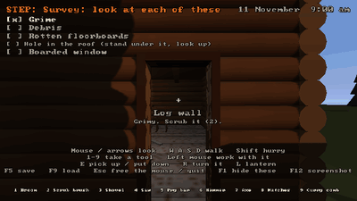
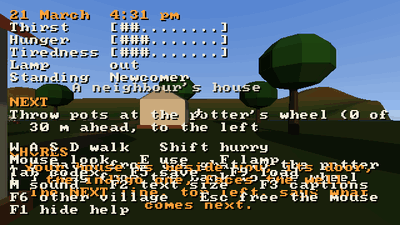
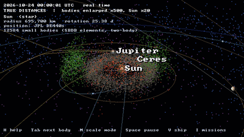

# The Strata driver: stepped sessions repeat frame for frame

Evidence for playtester 0.2.0's Strata driver ([Preponderous RFC 0027](https://github.com/Preponderous-Software/rfcs/pull/134)).
playtester is unreleased (0.2.0 is the next version), so this directory is named for it.

Three Strata games were each played **twice**, headless, by the same scripted
session through the Strata driver on a **stepped clock** (1/30 s a frame),
with a screenshot every 3 frames (0.1 s of game time) taken through the drive
channel. No X server, `xdotool` or ImageMagick was involved in playing; the
images below were assembled afterwards with ImageMagick.

| Game | Commit | Frames captured a run | Identical between the two runs |
| --- | --- | --- | --- |
| Kindling 0.1.2 (seed 1881) | `63e9bd4` | 82 | 82 |
| Atman (seed 1) | `822a588` | 71 | 71 |
| orrery (`--date 2026-10-24`) | `f740f70` | 69 | 69 |

All three games were built against Strata [`7f0c23e`](https://github.com/Preponderous-Software/strata/commit/7f0c23ea7c80b4d7494742d14adee4f94e050b26)
(ABI 1.12, the drive channel), 640x360, on llvmpipe (Mesa 21.2.6, WSL2).
Every frame's SHA-256 in both runs is in each game's `frames.json`, with the
script that was played.

Reproduce (from a playtester checkout, with the games built):

```bash
python examples/strata_driver_demo.py --profile kindling-strata --game-dir ~/kindling --seed 1881 \
    --out docs/playtests/0.2.0/strata-driver/kindling
python examples/strata_driver_demo.py --profile atman-strata --game-dir ~/atman --seed 1 \
    --out docs/playtests/0.2.0/strata-driver/atman
python examples/strata_driver_demo.py --profile orrery-strata --game-dir ~/orrery \
    --out docs/playtests/0.2.0/strata-driver/orrery -- --date 2026-10-24
```

## Kindling

Hide the help, walk through the door, look down at the floor and up again,
turn to the hearth, step forward, turn back. Mouse look is injected as exact
relative motion (the engine accepts relative mouse mode when driven).




The last frame of run 1, of run 2, and their difference (black: no pixel differs):


## Atman

Walk into the valley, look right with the mouse, walk on, look back and up,
hurry with Shift held.




## orrery

Speed time up three steps, orbit the camera by dragging, zoom in, orbit back.




## Not covered

- steading has a `steading-strata` profile, but its game build needs an
  OpenUSD prebuilt that does not run on the machine these were recorded on;
  its own CI builds and smoke-tests it.
- Beyond Nations keeps the X11 driver (its input comes from Silk.NET, not
  Strata; RFC 0027 Non-Goals).
- Identical frames were measured on one machine and one Mesa. The RFC claims
  no more than that (its Q5).
